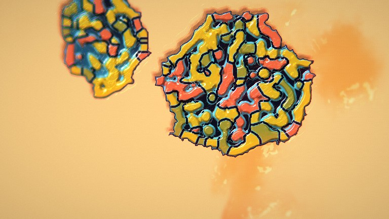
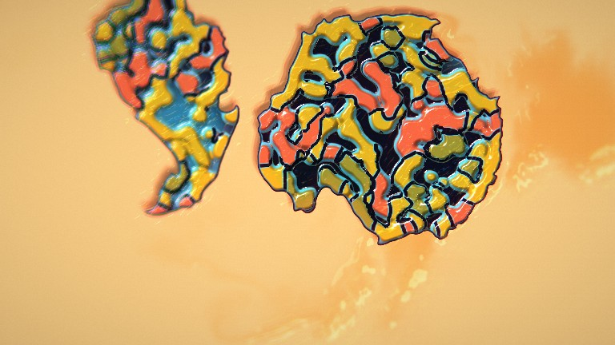

# Fluide microscopique

Fond d'écran animé pour [Wallpaper Engine](https://www.wallpaperengine.io/), inspiré des films de « fluid art » microscopique. Des taches couvertes de vers colorés (corail, moutarde, olive) séparés par des sillons noirs bordés de cyan flottent dans un liquide qui change d'état. Tout est calculé en temps réel en WebGL2 : aucune vidéo n'est utilisée.





## Les 4 états

Le fond d'écran passe de l'un à l'autre en continu. L'encre du nouvel état envahit progressivement l'écran.

1. **Corail irisé** : fond pêche, vers corail, moutarde et olive, sillons noirs bordés de cyan.
2. **Encre rose** : une goutte rose brillante traverse le liquide, avec des filets d'encre brune et des lignes de lumière.
3. **Encre rouge** : nuages d'encre rouge-orangée avec des particules sombres, sur un jaune vif.
4. **Huile ambrée** : liquide doré, motif plus sombre et grosses gouttes d'huile à bord orangé.

Le liquide suit la souris : il est poussé, étiré, et il garde la trace de l'encre. Un clic fait apparaître une nouvelle tache.

## Installation

### Avec git (mises à jour faciles)

```
git clone https://github.com/bey0ne/fluid-art-wallpaper "D:\Wallpaper\fluid-art-wallpaper"
```

Ensuite, reliez le dossier aux projets de Wallpaper Engine, en adaptant le chemin de Steam si besoin. Lancez cette commande dans une invite de commandes :

```
mklink /J "C:\Program Files (x86)\Steam\steamapps\common\wallpaper_engine\projects\myprojects\fluid-art-wallpaper" "D:\Wallpaper\fluid-art-wallpaper"
```

Le fond d'écran apparaît alors dans Wallpaper Engine. Pour récupérer une nouvelle version, double-cliquez sur `mettre-a-jour.bat`, puis réappliquez le fond d'écran.

### Sans git

Téléchargez le ZIP (**Code → Download ZIP**). Dans Wallpaper Engine, ouvrez **Ouvrir le fond d'écran → Ouvrir depuis un fichier** et choisissez `index.html`.

## Réglages

| Réglage | Effet |
| --- | --- |
| État | Cycle automatique, ou un des 4 états fixe |
| Durée de chaque état | En secondes |
| Vitesse | Vitesse du mouvement du liquide |
| Force de la souris | 0 désactive l'interaction |
| La souris dépose de l'encre | Laisse une traînée de couleur derrière le curseur |
| Quantité de taches | 1 à 3 taches à motif |
| Taille du motif | Plus la valeur est grande, plus les vers sont gros (et plus c'est léger pour la carte graphique) |
| Gouttes d'huile, Flou de profondeur, Halo lumineux | Effets de rendu |
| Qualité | « Auto » détecte les cartes graphiques intégrées (Intel Iris, etc.) et baisse la résolution si les images saccadent |

## Aperçu dans un navigateur

Ouvrez `index.html` dans Chrome ou Edge. Les réglages se testent par l'URL, par exemple `index.html?phase=1&speed=1.5&quality=0`.

## Fonctionnement

- **Fluide** : simulation Navier-Stokes sur GPU (advection, confinement de vorticité, projection de pression). Des émetteurs invisibles remuent le liquide et y déposent les encres.
- **Vers** : réaction-diffusion Gray-Scott, transportée par le fluide comme une matière visqueuse. Les paramètres changent selon l'état (vers longs, puis perles).
- **Couleur de chaque ver** : un champ de teinte tri-stable qui ne diffuse qu'à l'intérieur des vers. Chaque ver finit donc avec une seule couleur, et un sillon apparaît là où deux couleurs se touchent.
- **Rendu** : relief de chaque ver, reflets d'un éclairage de studio, ombre portée, réfraction par la surface du liquide, gouttes d'huile en lentilles, flou de profondeur, bloom, grain.
